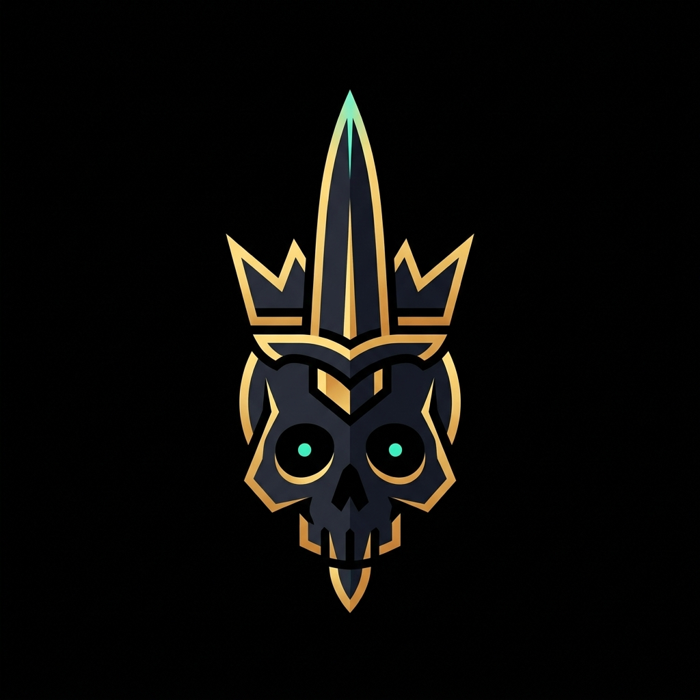
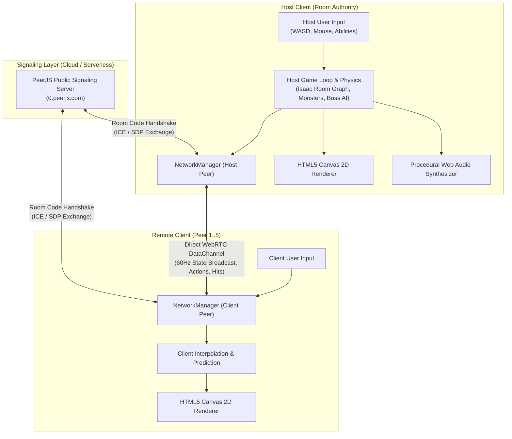

<p align="center">
  
  <h1 align="center">🗡️ SLOP DUNGEON 🎲</h1>
  <p align="center">
    <strong>A chaotic 1–6 player cooperative roguelike dungeon crawler built with pure HTML5 Canvas & WebRTC Peer-to-Peer multiplayer.</strong>
  </p>
  <p align="center">
    <a href="https://slop-dungeon.vercel.app"></a>
    <a href="https://github.com/felixpalingan/Slop-dungeon/blob/main/LICENSE"></a>
    
    
    
    
    
  </p>
</p>

---

## 📖 Overview

**Slop Dungeon** is a lightweight, zero-install, serverless roguelike dungeon crawler engineered for high-energy friend-group sessions. Jump straight into procedural chamber floors directly in any modern desktop web browser. 

🎮 **Live Production Deployment**: [https://slop-dungeon.vercel.app](https://slop-dungeon.vercel.app)

Players coordinate via ephemeral **6-character room codes** (`SLOP-XXXX`), equip over 54 distinct procedural items inspired by iconic anime archetypes, unleash screen-shattering cinematic ultimates, manage a shared party wallet of **Slops**, gamble items at the **Slop Merchant's Gacha Altar** (or Blackjack Table), and face multi-phase room-filling bosses.

---

## 🏛️ System Architecture

Slop Dungeon runs on a **Serverless Peer-to-Peer (P2P)** architecture. Game logic executes on the client and is synchronized across players via WebRTC DataChannels using PeerJS signaling.



### Engineering Stack & Rationale

| Layer | Technology | Engineering Rationale |
| :--- | :--- | :--- |
| **Rendering** | HTML5 Canvas 2D | 100% procedural rendering with zero sprite sheet asset download overhead; instant loading speeds and 60+ FPS on all devices. |
| **Networking** | WebRTC DataChannels (PeerJS) | True serverless multiplayer. Eliminates recurring dedicated server costs and achieves ultra-low latency direct P2P data replication. |
| **Audio** | Web Audio API Synthesizer | Zero audio MP3/WAV files loaded over the network; all sound effects (swords, blasts, heartbeats, gongs, coins) are procedurally generated via oscillators, gain nodes, and noise buffers. |
| **Build & Tooling** | Vite 5 | Lightning-fast Hot Module Replacement (HMR) and optimized single-bundle production output. |
| **Deployment** | Static Hosting (Vercel / GitHub Pages) | Fully static client distribution; automatically serves HTTPS required for browser WebRTC operations. |

---

## ⚡ Core Features & Gameplay Systems

### 1. ⚔️ Fast-Paced Combat & Kinetic Controls
- **Dynamic Melee Arcs**: Forward weapon thrusts, sweeping broadsword cleaves, dual snap blade cross-slashes, and 360° chain swings with accurate spatial collision boxes.
- **Shield Blocking & Parrying**: Active offhand blocking with directional angle mitigation and custom deflection audio.
- **Dodge Roll with i-Frames**: Directional dodge roll with invulnerability window, stamina drain, and customizable cost reduction boots.
- **Comic Slap Physics**: Right-click unarmed slap triggers a loud `BONK!` comic particle with physics knockback against friends and foes alike.

### 2. 🎴 Anime Equipment Sets & Cinematic Ultimates
Collect 6-slot modular gear (*Helmet*, *Chest*, *Pants*, *Boots*, *Weapon*, *Off-Hand*) spanning 5 rarity tiers (*Common*, *Rare*, *Epic*, *Legendary*, *Mythic*). Assembling full sets unlocks screen-clearing **Ultimate [Q] Abilities**:

| Archetype Set | Epithet / Title | Signature Ultimate Ability | Cinematic FX |
| :--- | :--- | :--- | :--- |
| **The Honored One** | Cursed Sorcerer | **Hollow Purple** | Screen collapses into a dark violet vortex, obliterating everything along its path with 320 True Damage. |
| **King of Curses** | Cursed Sovereign | **World Cutting Slash** | Freezes global viewport in monochrome gray before bisecting the screen with 350 True Damage. |
| **The Sorcerer Killer** | Heavenly Restriction | **Inverted Chain Rampage** | 360° rapid-spinning iron chain storm that shreds nearby foes and neutralizes enemy shields. |
| **The Black Swordsman** | The Berserker | **Berserker Rage** | Total invulnerability for 6 seconds, +85% attack speed, 35% lifesteal, and screen-shaking `CLANG!` impacts. |
| **Humanity's Strongest** | Titan Hunter | **ODM Grapple Whirlwind** | Dual wire grapple flight with collision-free pass-through, spinning 360° for 80 damage per slice. |
| **Night City Legend** | Cyber Sandevistan | **Sandevistan Time Dilation** | Global time dilation slows the entire world and all enemies to 10% speed for 4 seconds. |

*Full equipment details are available in the [Item Encyclopedia](ANIME_EQUIPMENT.md).*

### 3. 🩸 Downed State, Co-op Revive & Party Wipe
- **Dynamic Lethal Damage Routing**: In solo play, reaching 0 HP causes instant death and triggers the Party Wipe modal immediately without bleedout delay.
- **Co-op Crawl State**: In multiplayer, if at least one teammate remains standing, taking fatal damage puts the player into a 30-second Downed crawl state. Teammates can stand near and hold `[E]` for 2.5s to revive with 40% HP.
- **Run Summary Screen**: Detailed game over statistics tracking floors cleared, dungeon elapsed time, total kills, and Run MVP awards.

### 4. 🪙 Slop Economy, Merchant & Gambling Altars
- **Shared Party Slops**: Defeated enemies and bosses drop physical slop coins that magnetize toward players.
- **The Slop Merchant**: Sells health flasks and stamina tonics, and buys unwanted equipment.
- **Spelunky RPG Retaliation**: Attacking or slapping the merchant causes him to draw a military RPG and fire explosive rockets at the instigator!
- **Trade-Up Forge**: Sacrifice 3 items of identical rarity to forge 1 guaranteed item of the next rarity tier.
- **Spin-a-Wheel Gacha Altar**: Wager any equipment piece (50% Shatter into ash, 45% Upgrade rarity tier, 5% Jackpot Secret Mythic).
- **In-Lobby Blackjack Table**: Sit at the green felt table in Base Camp to wager Slops in a complete dealer blackjack game.

### 5. 🏕️ Base Camp Lobby & Dev Tools
- **Interactive Wardrobe Mirror**: Customize player avatar color hex code and multiplayer display name.
- **Dev Armory Chest (`[G]`)**: Interactive sandbox chest allowing instant one-click equipping of any anime set or item.
- **Floor Selector Terminal (`[F]`)**: Teleport straight to any themed floor (JJK Detention Center, Cyberpunk Arasaka Sublevel, AoT Wall Maria Crypts).

---

## 🛠️ Local Development Setup

### Prerequisites
- [Node.js](https://nodejs.org/) (version 18.0.0 or higher)
- [npm](https://www.npmjs.com/) (version 9.0.0 or higher)
- A modern desktop web browser supporting WebRTC and Canvas 2D (Chrome, Firefox, Edge, Safari, Brave)

### Installation
1. **Clone the repository**:
   ```bash
   git clone https://github.com/felixpalingan/Slop-dungeon.git
   cd Slop-dungeon
   ```

2. **Install project dependencies**:
   ```bash
   npm install
   ```

3. **Start the local development server**:
   ```bash
   npm run dev
   ```
   Open your browser to the URL displayed in the terminal (default: `http://localhost:3000`).

4. **Build production bundle**:
   ```bash
   npm run build
   ```
   The compiled static assets will be output to the `dist/` directory, ready to deploy to Vercel, Netlify, or GitHub Pages.

---

## 🌐 Deploying to Vercel

Because Slop Dungeon utilizes client-side WebRTC P2P for networking, it can be deployed to Vercel with zero backend configuration:

1. Push your repository to GitHub.
2. Import the project in [Vercel](https://vercel.com).
3. Vercel will auto-detect the **Vite** preset:
   - **Build Command**: `npm run build`
   - **Output Directory**: `dist`
4. Click **Deploy**. Vercel will automatically provision a secure HTTPS domain required for WebRTC operation.

---

## 📜 Governance & Documentation

- **[LICENSE](LICENSE)**: Open-source MIT License terms and conditions.
- **[CONTRIBUTING.md](CONTRIBUTING.md)**: Coding conventions, pull request workflows, and issue reporting standards.
- **[SECURITY.md](SECURITY.md)**: Vulnerability disclosure policies and maintainer contact points.
- **[ROADMAP.md](ROADMAP.md)**: Phased engineering roadmap and multi-discipline architecture plan.
- **[ANIME_EQUIPMENT.md](ANIME_EQUIPMENT.md)**: Comprehensive master catalog of all 54 items, stats, and set bonus mechanics.

---

## 👤 Author

Developed by **Felix Palingan**  
- GitHub: [@felixpalingan](https://github.com/felixpalingan)
- Repository: [felixpalingan/Slop-dungeon](https://github.com/felixpalingan/Slop-dungeon)

*Copyright (c) 2026 Felix Palingan. All rights reserved under the MIT License.*
